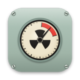
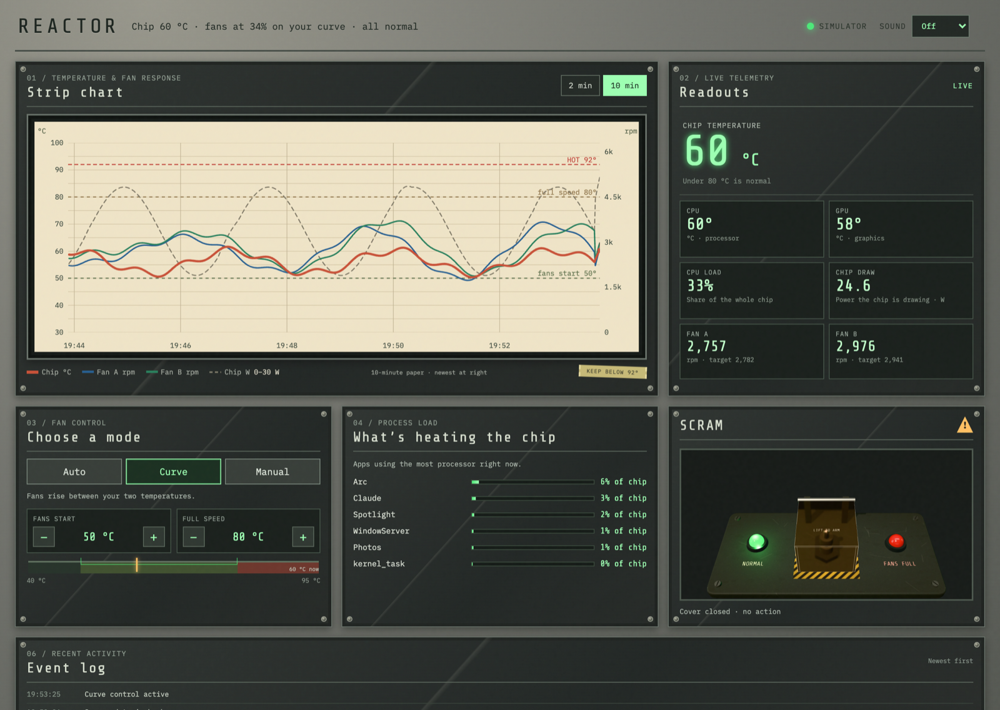
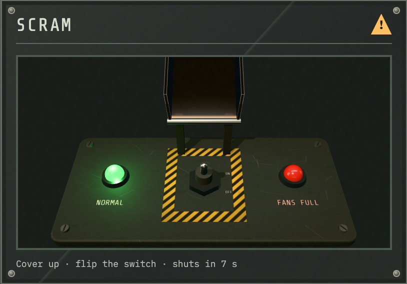
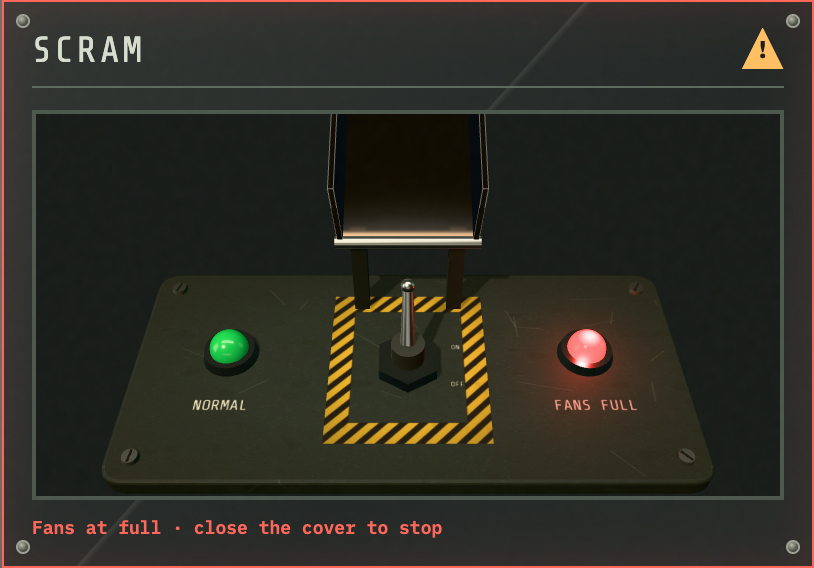

<p align="center"></p>

# Fan Control Reactor

A free fan controller for Apple Silicon MacBook Pros, dressed up as a reactor control panel.
The chip is the core, the two fans are the coolant pumps, and there is a real SCRAM switch under a glass cover.

I built it because the paid fan apps charge for custom fan curves. Reactor gives you the curve, a live chart and
a big red switch for nothing. It runs as a small background service, so the fans stay on your settings after you
close the window or restart the Mac.



| Lift the glass cover… | …flip the switch: both fans go to full |
| --- | --- |
|  |  |

Try the SCRAM switch in your browser: **[scram-switches.vercel.app](https://scram-switches.vercel.app)**

## What's on the panel

- **Strip chart.** Chip temperature, both fan speeds and chip power on scrolling graph paper, with your curve's
  start and full-speed lines printed on it. Hover for the exact values at any moment. 2 or 10 minutes of history.
- **Readouts.** Chip, CPU and GPU temperature, CPU load, power draw and each fan's speed against its target.
- **What's heating the chip.** The six apps using the most processor right now, as a share of the whole chip.
- **Choose a mode.**
  - *Auto*: macOS runs the fans as usual.
  - *Curve*: fans stay with macOS until your start temperature, then ramp linearly to full speed at your
    full temperature.
  - *Manual*: one fixed speed.
- **SCRAM.** A 3D glass flip cover over a missile switch (three.js). Lift the cover, flip the switch, and both fans
  run at full. Closing the cover knocks the switch back off and returns to your previous mode. The cover shuts by
  itself after 8 seconds if you leave it open. Space or Enter works too.
- **Event log and alarms.** Mode changes, hot-chip warnings and sensor problems, with optional alarm sounds.

## Safety

- At **95 °C** both fans are forced to full whatever the mode (the INTERLOCK alarm). It releases below 85 °C.
- If temperature readings stop for 10 seconds, the fans go back to macOS control.
- On any exit, crash or uninstall, the fans are handed back to macOS.
- The API listens on `127.0.0.1` only and rejects requests from other hosts.

Built and tested on a 14" MacBook Pro (M1 Pro, two fans). Other Apple Silicon MacBook Pros should work, since the
fan limits are read from the machine, but they are untested. Fan control writes to the SMC as root. Use it at your
own risk.

## How it fits together

| Part | What it does |
| --- | --- |
| `smc/smcfan.c` | Tiny AppleSMC tool: reads fan speeds as any user, sets them as root. |
| `daemon/reactord.py` | The root background service: control loop, safety interlock, JSON API, and it serves the panel on `127.0.0.1:7979`. Reads temperatures and power from [macmon](https://github.com/vladkens/macmon). |
| `ui/` | The panel itself: plain HTML, CSS and JavaScript, plus three.js for the SCRAM switch. |
| `app/ReactorApp.swift` | A small native window around the panel, with a title bar that matches it. Closing it only closes the window. |
| `mockups/` | The design exploration: three earlier control-room directions and the SCRAM switch gallery. |

## Install

You need the Xcode Command Line Tools (`xcode-select --install`) and macmon (`brew install macmon`).
Quit any other fan-control app first, since two controllers will fight over the fans.

```sh
git clone https://github.com/AshadMohammed/fan-control-reactor.git
cd fan-control-reactor
./smc/build.sh                 # builds the SMC helper
./app/build.sh                 # builds Reactor.app
sudo ./install.sh              # installs and starts the background service
open app/build/Reactor.app     # or open http://127.0.0.1:7979/ in a browser
```

The service runs from `/Library/Application Support/Reactor/`, keeps its settings in `config.json` there,
and writes its log to `/Library/Logs/Reactor.log`. It starts at boot, before anyone logs in.

### Remove

```sh
sudo ./uninstall.sh
```

This stops the service, hands the fans back to macOS and removes the install folder. The log is kept.

## Try it without touching the fans

Open the panel with its built-in simulator:

```sh
python3 -m http.server 8000 -d ui
open "http://127.0.0.1:8000/?demo=1"
```

Or run the real service in dry-run mode. It reads the real sensors and logs the fan writes it would make, without
making them:

```sh
python3 daemon/reactord.py --smcfan ./smc/smcfan --macmon "$(command -v macmon)" \
  --ui ./ui --state-dir /tmp/reactor-state --dry-run
```

## API

`GET /api/state` returns the whole panel state (add `?since=<epoch>` to trim the history). POSTs need the header
`X-Reactor: 1` and a JSON body:

| Endpoint | Body |
| --- | --- |
| `POST /api/mode` | `{"mode": "auto" \| "curve" \| "manual" \| "scram"}` |
| `POST /api/curve` | `{"start_c": 40–85, "full_c": start+5–95}` |
| `POST /api/manual` | `{"pct": 0–100}` |
| `POST /api/ack` | acknowledges all active alarms |  

## Credits

- [three.js](https://threejs.org) (MIT), vendored in `ui/vendor/` and `mockups/vendor/`.
- [macmon](https://github.com/vladkens/macmon) (MIT) for sudoless temperature and power readings.
- Fonts: IBM Plex Mono and Share Tech Mono from Google Fonts.

## License

MIT. See [LICENSE](LICENSE).
